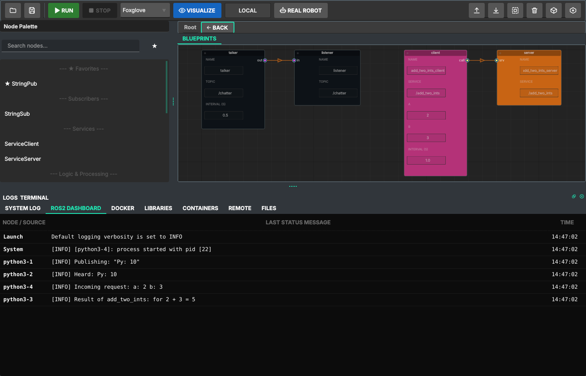

# ROS 2 Blueprint Studio

**A visual editor for ROS 2 that produces real ROS 2 code.** Draw nodes and wires, and Studio
generates the package (C++ and Python sources, `CMakeLists.txt`, `package.xml`, launch files,
Dockerfile), builds it with colcon and runs it in Docker. The same project builds and runs on a
robot over SSH. No local ROS 2 installation needed: it works on **Windows** and Linux.



> **Status:** 0.6.0, alpha. It is used on a real humanoid project, but expect rough edges.
> Read [Known limitations](docs/KNOWN_LIMITATIONS.md) before you start.

## What it does

- **Graph → real package.** Every node is a file you own (`src/cpp/*.cpp`, `src/python/*.py`).
  Double-click a node to edit it in your editor; your edits are kept. `CMakeLists.txt` and
  `package.xml` are generated, with dependencies taken from your `#include`s and imports, and a
  `USER` block in `CMakeLists.txt` for anything the generator does not know.
- **Topics and services.** Publishers, subscribers, service servers and clients in Python and
  C++. A wire keeps the topic/service names of connected nodes in step; Save warns if they differ.
- **Run in Docker.** One click: save, build (colcon for C++), launch, logs per node on the
  ROS2 Dashboard. The local session is isolated from your network unless **Real robot** is on.
- **Live parameters.** Right-click a running node → *Parameters…*: sliders for declared ranges,
  the node's own refusals shown, values saved to `src/config/params.yaml` and passed by the
  generated launch. On a real robot: no values while dragging, confirmation for big jumps.
- **Managed nodes.** Freeze / Unfreeze lifecycle nodes, locally or on the robot.
- **Robot over SSH.** The Remote tab syncs sources to the robot (changed files only, conflicts
  detected, nothing outside the project touched), builds there with colcon, streams the output,
  cancels cleanly, and warns before building code older than your project.
- **Deploy groups.** Split a graph between machines: one launch file per group and a
  `docker-compose.yml`.
- **Foxglove** visualization without an X server; classic X11/RViz mode is available too.
- Node palette with search, language filter and favorites; user palettes you can share;
  English and Russian UI.

## Learn ROS 2 with it

The tutorials follow the official ROS 2 Humble tutorials in Studio: what you do instead of the
terminal, what Studio generates, and where it differs. Every chapter's project was built and run
against ROS 2 Humble. Read them on the **[documentation site](https://neiroevgen.github.io/ros2-blueprint-studio/)**
(search, chapter navigation) or here in [docs/tutorials](docs/tutorials/README.md).

| | |
|---|---|
| 1. [Workspace, package and build](docs/tutorials/01-workspace-and-package.md) | 5. [Looking at a running system](docs/tutorials/05-inspecting-a-running-system.md) |
| 2. [Publisher and subscriber (Python)](docs/tutorials/02-publisher-subscriber-python.md) | 6. [Parameters, tuned live](docs/tutorials/06-parameters.md) |
| 3. [Publisher and subscriber (C++)](docs/tutorials/03-publisher-subscriber-cpp.md) | 7. [Launch files](docs/tutorials/07-launch-files.md) |
| 4. [Service and client](docs/tutorials/04-service-client.md) | |

## Install

You need **Docker**: [Docker Desktop](https://www.docker.com/products/docker-desktop/) on Windows,
Docker Engine on Linux. The first Run pulls the ROS 2 Humble image (a few GB) and takes a few
minutes; later Runs take seconds.

**Release build (Windows):** download `ROS2Studio.exe` from [Releases](../../releases) and run it.

**From source** (Windows or Linux, tested with Python 3.13):

```bash
git clone https://github.com/NeiroEvgen/ros2-blueprint-studio.git
cd ros2-blueprint-studio
python -m venv venv
venv\Scripts\activate            # Linux: source venv/bin/activate
pip install -r requirements.txt
python main.py
```

## Quick start

1. Start Studio, create a project (lowercase name, language Python or C++).
2. Drag **StringPub** and **StringSub** from the palette onto the canvas.
3. Wire **out** to **in**.
4. Press **Run**. The **ROS2 Dashboard** tab shows `Publishing: "Py: 0"` and `Heard: Py: 0`.
5. Right-click `talker` → **Parameters…**, or open its file with a double-click.

[Chapter 2](docs/tutorials/02-publisher-subscriber-python.md) walks through this in detail.

## Examples

Open with **Open from Disk…** in the start window:

| Folder | What it shows |
|---|---|
| `examples/py_pubsub` | Python publisher → Python subscriber on `/chatter` |
| `examples/cpp_pubsub` | C++ publisher → C++ subscriber (built with colcon) |
| `examples/mixed_pubsub` | Python publisher → C++ subscriber on **one canvas** |
| `examples/hand_teleop` | Larger demo: hand tracking on the host (Python) driving C++ arm control and rendering |

The `*_pubsub` projects are generated by Studio itself (`python -m tools.make_examples`), so they
always match the current project format.

## Working with a robot

1. **Remote** tab: host, user, workspace on the robot, optionally the container to build in.
   The password is asked when you connect and never stored; the host key is checked on every
   connection.
2. **Connect → Sync → Build.** Build checks first that the robot has your current files.
3. Turn on **Real robot** in the toolbar when Studio should talk to robots on your network: the
   Parameters window then sends values on release and asks before big changes.

Studio is not a safety system. Keep the robot's own emergency stop at hand.

## Build the executable

PyInstaller has to pack the data files Studio reads at run time (translations, templates,
the dependency registry, the parameter bridge, the bundled palettes):

**Windows** (PowerShell or CMD):

```bash
pyinstaller --noconsole --onefile --clean --name ROS2Studio ^
  --add-data "assets;assets" --add-data "locales;locales" ^
  --add-data "core/generators/dependency_registry.json;core/generators" ^
  --add-data "core/generators/templates;core/generators/templates" ^
  --add-data "core/param_bridge.py;core" ^
  --add-data "nodes/user_palettes;nodes/user_palettes" ^
  --collect-all qt_material --hidden-import PySide6.QtSvg --hidden-import PySide6.QtXml ^
  --hidden-import NodeGraphQt main.py
```

(In PowerShell use a backtick `` ` `` instead of `^` at the line ends, or write it on one line.)

**Linux:** the same with `:` instead of `;` inside `--add-data` and `\` at the line ends.

The packed app keeps user palettes in Studio's settings folder (`~/.ros_blueprint_studio`), so
palettes you save survive restarts.

## Development

```bash
pip install pytest
python -m pytest -q
```

About 880 tests, Qt offscreen. Tests that need a real ROS 2 Humble run when Docker has the
`ros:humble-ros-core` image (and `studio-test:humble-srv` for services); otherwise they are
skipped. Tests with SSH use a local `sshd` and are skipped without it (and on Windows).

Project layout:

```
core/        generation, Docker, remote, parameters (no Qt)
ui/          the Qt interface
nodes/       palette nodes and their code templates
docs/        tutorials and known limitations
examples/    example projects
tests/       pytest
```

## License

[MIT](LICENSE)
