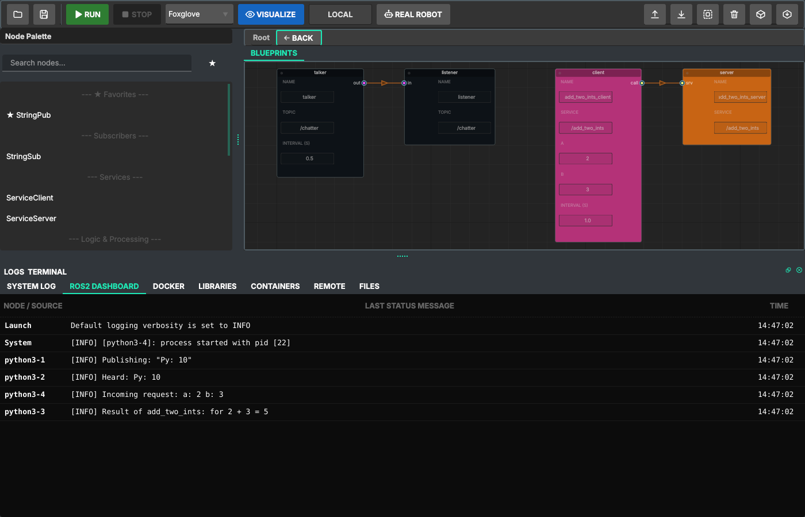

# ROS 2 Blueprint Studio

**A visual editor for ROS 2 that produces real ROS 2 code.** Draw nodes and wires, and Studio
generates the package (C++ and Python sources, `CMakeLists.txt`, `package.xml`, launch files,
Dockerfile), builds it with colcon and runs it in Docker. The same project builds and runs on a
robot over SSH. No local ROS 2 installation needed: it works on Windows and Linux.

## Where to start

- **New to ROS 2, or to Studio?** The [tutorials](tutorials/README.md) follow the official
  ROS 2 Humble tutorials in Studio, chapter by chapter, starting from
  [creating a package](tutorials/01-workspace-and-package.md).
- **Installing:** see [Install](https://github.com/NeiroEvgen/ros2-blueprint-studio#install) in the
  repository (Docker is the only requirement besides Studio itself).
- **Before a real project:** read the [known limitations](KNOWN_LIMITATIONS.md).

## What Studio does

| | |
|---|---|
| **Graph → real package** | every node is a file you own; `CMakeLists.txt` and `package.xml` are generated, with a `USER` block for your own CMake |
| **Topics and services** | publishers, subscribers, service servers and clients in Python and C++; wires keep names in step |
| **Run in Docker** | save, build, launch and per-node logs in one click; the local session is isolated from your network |
| **Live parameters** | sliders for declared ranges, the node's own refusals shown, values saved for the next run |
| **Managed nodes** | Freeze / Unfreeze lifecycle nodes, locally or on the robot |
| **Robot over SSH** | sync only what changed, detect conflicts, build with colcon on the robot, cancel cleanly |
| **Deploy groups** | one launch file per group and a `docker-compose.yml` to split a graph between machines |

> [!CAUTION]
> Studio is not a safety system. On a real robot keep its own emergency stop at hand.
