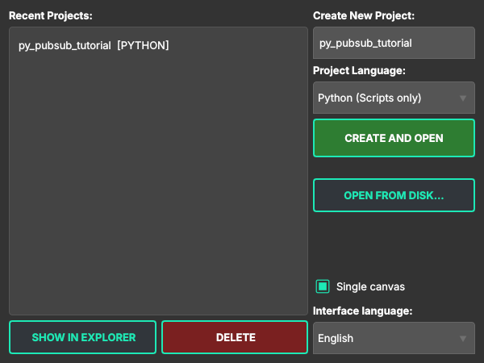

# 1. Workspace, package and build

Official tutorials: [Creating a workspace](https://docs.ros.org/en/humble/Tutorials/Beginner-Client-Libraries/Creating-A-Workspace/Creating-A-Workspace.html) ·
[Creating a package](https://docs.ros.org/en/humble/Tutorials/Beginner-Client-Libraries/Creating-Your-First-ROS2-Package.html) ·
[Using colcon to build packages](https://docs.ros.org/en/humble/Tutorials/Beginner-Client-Libraries/Colcon-Tutorial.html)

## What the official tutorial does

```bash
mkdir -p ~/ros2_ws/src && cd ~/ros2_ws/src
ros2 pkg create --build-type ament_python py_pubsub     # or ament_cmake for C++
cd ~/ros2_ws && colcon build
source install/setup.bash
```

A **workspace** is a folder with `src/`; every folder in `src/` with a `package.xml` is a
**package**; `colcon build` builds them into `install/`, and `source install/setup.bash` makes the
result visible to `ros2 run` / `ros2 launch`.

## In Studio

One Studio project is one ROS 2 package. Create it in the start window:



1. **Create New Project**: type a name. Only lowercase letters, digits and `_`, starting with a
   letter: the same rule ROS uses for package names ([REP 144](https://ros.org/reps/rep-0144.html)).
   Studio refuses other names instead of producing a package that fails later.
2. **Project Language**:
   - *Python (Scripts only)*: Python nodes, no build step;
   - *C++ (Compilation required)*: C++ nodes, built with colcon on every Run;
   - *Mixed*: both in one package.
3. **Create and Open**.

Projects live in `Documents/BlueprintStudioProjects/<name>` (*Show in Explorer* opens the folder).

## What Studio creates

After the first **Save** (the disk icon in the toolbar; **Run** saves first as well):

```
my_project/
├── src/                     <- the ROS 2 package: everything ROS works with
│   ├── python/  or  cpp/    <- one file per node on the canvas
│   ├── launch/              <- generated launch files (chapter 7)
│   ├── CMakeLists.txt       <- C++ projects only, generated
│   ├── package.xml          <- C++ projects only, generated
│   └── config/params.yaml   <- appears when you save parameters (chapter 6)
├── Dockerfile               <- the image the project runs in
├── .blueprint/              <- Studio's own state (canvas, generated-files list); not ROS
└── project_config.json
```

## How this maps to the official workspace

| Official tutorial | Studio |
|---|---|
| `~/ros2_ws` | `/root/ros2_ws` inside the session container |
| `~/ros2_ws/src/<package>` | your project's `src/`, mounted as `/root/ros2_ws/src/user_project` |
| package name | the project folder name |
| `ros2 pkg create --build-type ament_cmake` | a C++ project: `CMakeLists.txt` and `package.xml` are generated on Save |
| `colcon build` | done by **Run** when the project has C++ (`colcon build --symlink-install`) |
| `source install/setup.bash` | done by **Run** before starting the nodes |

## Where Studio differs (and what you still need to know)

- **Python nodes are scripts, not an `ament_python` package.** The official tutorial adds
  `setup.py`, `setup.cfg` and `entry_points` so that `ros2 run py_pubsub talker` works. Studio skips
  that: the generated launch file starts each Python node as `python3 -u <file>`. There is nothing to
  build, so a change to a Python node is live on the next Run. The cost: `ros2 run <package> <node>`
  does not work for Studio's Python nodes; use the launch file.
- **`CMakeLists.txt` is generated, but it is yours too.** Studio rewrites it on every Save from the
  nodes on the canvas and the `#include`s in your code (it adds `find_package` and dependencies
  itself). Put your own additions between `# === BLUEPRINT USER BEGIN` and
  `# === BLUEPRINT USER END` at the end of the file: that block is kept as is.
- **Dependencies are filled from your code.** Including `nav_msgs/msg/odometry.hpp` in a C++
  node adds `nav_msgs` to `CMakeLists.txt` and `package.xml`, and `ros-humble-nav-msgs` to the
  Dockerfile. Understanding *why* a package needs
  a dependency is still on you: it is the first thing to check when a build fails.
- **The container is the workspace.** Everything ROS runs inside Docker. Your files stay on your
  disk; the container only mounts `src/`. `build/`, `install/` and `log/` live in the container.

> [!IMPORTANT]
> **A local run stays on your computer.** Studio starts the session with `ROS_LOCALHOST_ONLY=1`:
> your nodes do not see, and cannot command, robots on the same network, even in the same
> `ROS_DOMAIN_ID`. Turn on **Real robot** (toolbar) to open the session to the network; the
> container is recreated on the next Run when this or the domain/DDS settings change.

## Try it

1. Create a Python project `py_pubsub_tutorial`.
2. Press Save: `src/` gets `python/` and `launch/`; there are no nodes yet.
3. Continue with [chapter 2](02-publisher-subscriber-python.md).
