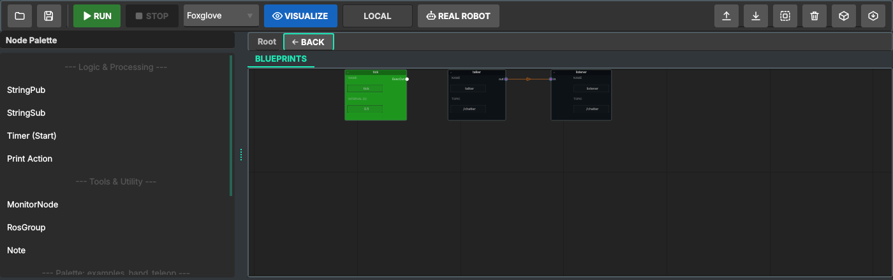
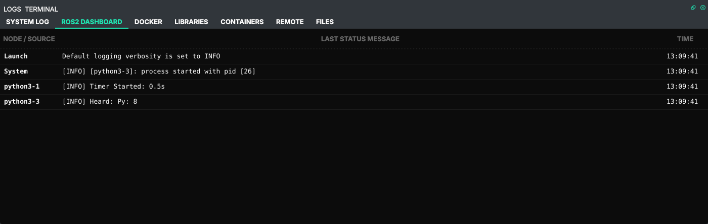

# 2. Publisher and subscriber (Python)

Official tutorial: [Writing a simple publisher and subscriber (Python)](https://docs.ros.org/en/humble/Tutorials/Beginner-Client-Libraries/Writing-A-Simple-Py-Publisher-And-Subscriber.html)

## What the official tutorial does

Two nodes in one package. `minimal_publisher` creates a publisher on the topic `topic` and a 0.5 s
timer; on every tick it publishes a `std_msgs/String` "Hello World: N". `minimal_subscriber`
subscribes to the same topic and logs what it hears. They know nothing about each other: ROS
connects them because they use **the same topic name and message type**.

## In Studio

Start from the Python project of [chapter 1](01-workspace-and-package.md).

1. From the **Node Palette** drag three nodes onto the canvas:
   **Timer (Start)**, **StringPub**, **StringSub**.
2. Fill the fields on the nodes:

   | Node | Name | Other fields |
   |---|---|---|
   | Timer (Start) | `tick` | Interval (s): `0.5` |
   | StringPub | `talker` | Topic: `/chatter` |
   | StringSub | `listener` | Topic: `/chatter` |

   *Name* is the ROS node name (what `ros2 node list` shows); the file on disk is named after the
   node's title on the canvas.
3. Connect **out** of `talker` to **in** of `listener`.
4. **Run**. Studio saves, starts the session container and launches the nodes.



The output is on the **ROS2 Dashboard** tab: one row per process with its last message;
double-click a row for its whole log.



`listener` prints `Heard: Py: 0`, `Py: 1`, ... twice a second. Python nodes appear as
`python3-1`, `python3-2`, ... : these are launch's process names, numbered in the order of the
launch file (`tick`, `talker`, `listener` here). `talker` itself does not log; only the listener does.

## What Studio generated

`src/python/talker.py` (comments trimmed):

```python
class talker(Node):
    def __init__(self):
        super().__init__('talker')
        self.pub = self.create_publisher(String, '/chatter', 10)
        self.trigger_sub = self.create_subscription(String, 'topic_1', self.trigger_callback, 10)
        self.i = 0

    def trigger_callback(self, msg):
        out_msg = String()
        out_msg.data = f"Py: {self.i}"
        self.pub.publish(out_msg)
        self.i += 1
```

`src/python/listener.py` is the official subscriber almost line by line: `create_subscription(String,
'/chatter', self.callback, 10)` and a callback that logs `Heard: ...`. `src/launch/project_launch.py`
starts all three files.

## Where Studio differs from the official tutorial

- **The publisher has no timer of its own.** In the official code the timer lives inside
  `minimal_publisher`. Studio's palette splits *when* from *what*: **Timer (Start)** publishes a
  tick on `topic_1`, and every node with a trigger subscription (here `talker`) acts on it.
  One timer can drive several publishers. Without a Timer node on the canvas, `talker` never
  publishes, and the listener stays silent. (The C++ publisher in chapter 3 has its own timer.)
- **The wire does not create the topic. The Topic field does.** ROS connects nodes by topic name, and
  Studio writes the *Topic* field into the code. The wire shows the connection on the canvas, but if
  the two Topic fields differ, the nodes will not talk even with a wire between them. Keep them equal.
- **Your edits stay.** Double-click a node to open its file in your editor. As long as the code is
  Studio's unchanged template, Studio fills in the names on Save; once you edit it, your version is
  kept. From then on the code decides, not the node's fields: the ROS node name is whatever
  `super().__init__(...)` says, the topic is whatever `create_publisher` says.

### Variant: exactly the official publisher

1. Double-click `talker` and replace the whole file with the tutorial's `publisher_member_function.py`.
2. In it, change the topic `'topic'` to `'/chatter'`, the one `listener` subscribes to.
3. Delete the Timer node: the official publisher has its own timer. On Save, Studio moves the
   no longer used `tick.py` to `.blueprint/trash/` instead of deleting it.
4. **Run**. The dashboard shows `Publishing: "Hello World: 0"` from the publisher and
   `Heard: Hello World: 0` from `listener`; `ros2 node list` now shows `/minimal_publisher`
   instead of `/talker`, the name from the code.

## Check it like the official tutorial

The official tutorial checks the result with `ros2 topic echo`. The session container is a normal
ROS 2 environment, so the same commands work there:

```bash
docker exec -it ros2_orchestrator_session bash
source /opt/ros/humble/setup.bash
ros2 node list          # /listener  /talker  /tick
ros2 topic list         # /chatter  /parameter_events  /rosout  /topic_1
ros2 topic echo /chatter
```

## What you learned

| Concept (official tutorial) | Where it is in Studio |
|---|---|
| publisher, `create_publisher(type, topic, qos)` | StringPub node, *Topic* field |
| subscriber and callback | StringSub node, `callback` in its file |
| timer | Timer (Start) node, *Interval* field |
| nodes are matched by topic name and type | the *Topic* fields, not the wire |
| `setup.py` entry points, `ros2 run` | not used: the launch file runs the scripts ([chapter 1](01-workspace-and-package.md)) |

Next: the same pair in C++ (chapter 3, planned).
