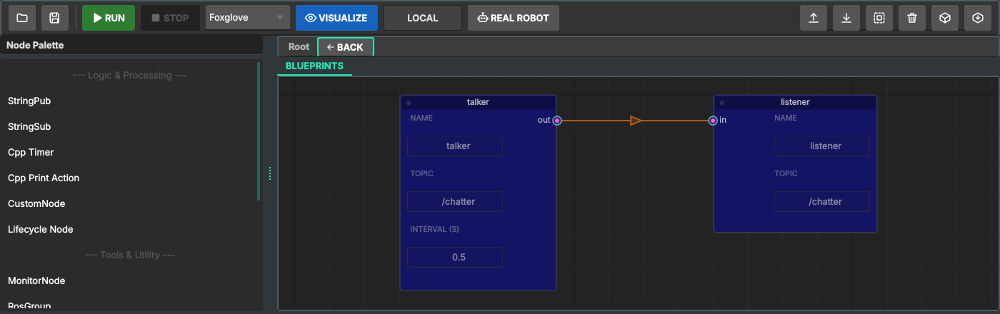
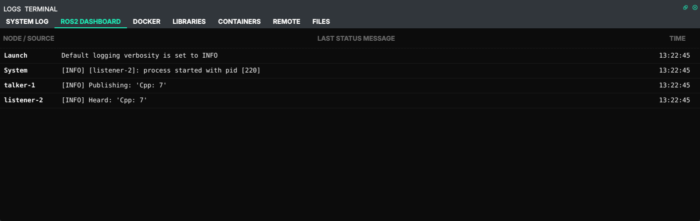

# 3. Publisher and subscriber (C++)

Official tutorial: [Writing a simple publisher and subscriber (C++)](https://docs.ros.org/en/humble/Tutorials/Beginner-Client-Libraries/Writing-A-Simple-Cpp-Publisher-And-Subscriber.html)

## What the official tutorial does

The same pair as in [chapter 2](02-publisher-subscriber-python.md), in C++: `publisher_member_function.cpp`
publishes "Hello, world! N" every 500 ms, `subscriber_member_function.cpp` prints what it hears.
Unlike Python, C++ has to be compiled, so the tutorial also edits `package.xml` (dependencies) and
`CMakeLists.txt` (`find_package`, `add_executable`, `ament_target_dependencies`, `install`), runs
`colcon build`, and starts the nodes with `ros2 run cpp_pubsub talker`.

## In Studio

1. Create a **C++** project `cpp_pubsub_tutorial` ([chapter 1](01-workspace-and-package.md)).
2. Drag **StringPub** and **StringSub** from the palette. On a C++ project the palette offers
   the C++ versions of the same nodes.
3. Names `talker` and `listener`; Topic `/chatter` and Interval `0.5` on `talker`.
4. Wire **out** to **in**: `listener` takes the topic, as in chapter 2.
5. **Run**. Studio saves, generates `CMakeLists.txt` and `package.xml`, runs `colcon build` in the
   container (the build output goes to the System Log), then launches both nodes.





C++ nodes appear under their executable names (`talker-1`, `listener-2`), not as `python3-N`:
the launch file starts them as ROS nodes from the package.

## What Studio generated

`src/cpp/talker.cpp`:

```cpp
class talker : public rclcpp::Node {
public:
    talker() : Node("talker"), count_(0) {
        publisher_ = this->create_publisher<std_msgs::msg::String>("/chatter", 10);
        timer_ = this->create_wall_timer(std::chrono::duration<double>(0.5), [this](){
            auto msg = std_msgs::msg::String();
            msg.data = "Cpp: " + std::to_string(count_++);
            publisher_->publish(msg);
            RCLCPP_INFO(this->get_logger(), "Publishing: '%s'", msg.data.c_str());
        });
    }
    ...
};
```

The official code puts the timer callback into a member function bound with `std::bind`; Studio's
template uses a lambda. Both are ordinary `rclcpp`.

`src/CMakeLists.txt`, the part the official tutorial writes by hand:

```cmake
find_package(rclcpp REQUIRED)
find_package(std_msgs REQUIRED)
...
add_executable(talker cpp/talker.cpp)
ament_target_dependencies(talker ... rclcpp ... std_msgs)
install(TARGETS talker DESTINATION lib/${PROJECT_NAME})
```

and `src/package.xml` with `<depend>rclcpp</depend>`, `<depend>std_msgs</depend>`.

## How the build steps map

| Official tutorial | Studio |
|---|---|
| add `<depend>` to `package.xml` | generated from the `#include`s of your nodes |
| `find_package`, `add_executable`, `ament_target_dependencies`, `install` | generated: one executable per `.cpp` with `main()` |
| `colcon build --packages-select cpp_pubsub` | **Run** builds the whole workspace in the container |
| `source install/setup.bash` | done by **Run** |
| `ros2 run cpp_pubsub talker` | **Run** starts the launch file; `ros2 run` works too (below) |

## Where Studio differs (and what you still need to know)

- **Extra dependencies.** Every executable is linked with a base set: `rclcpp`, `std_msgs`, and also
  `geometry_msgs`, `sensor_msgs`, `rclcpp_action`, `rclcpp_lifecycle`. The official tutorial needs only
  the first two. It builds and runs the same; the build is a little longer.
- **Compile errors are yours to read.** Studio runs colcon and shows its output in the System Log.
  A typo in your `.cpp` fails the build exactly like in the terminal, with the same compiler message.
- **Helpers without `main()` are not nodes.** A `.cpp` without `int main(` is compiled into the nodes
  that `#include` its header, and is not started by launch.
- **Your own CMake goes into the USER block** at the end of `CMakeLists.txt` (chapter 1): extra
  libraries, `target_sources`, compile options. The rest of the file is rewritten on every Save.

## Check it like the official tutorial

C++ nodes are a real package, so the official commands work in the session container:

```bash
docker exec -it ros2_orchestrator_session bash
source /opt/ros/humble/setup.bash
source /root/ros2_ws/install/setup.bash
ros2 run cpp_pubsub_tutorial talker      # a second publisher, from the terminal
ros2 topic echo /chatter
```

## What you learned

| Concept (official tutorial) | Where it is in Studio |
|---|---|
| `rclcpp::Node` subclass with a publisher and a wall timer | StringPub node (C++), *Topic* and *Interval* fields |
| subscription with a callback | StringSub node (C++) |
| `package.xml` dependencies | generated from `#include`s |
| `CMakeLists.txt` executables and install rules | generated; your additions in the USER block |
| `colcon build`, `source`, `ros2 run` | **Run**; `ros2 run` also works in the container |

Next: service and client (chapter 4).
