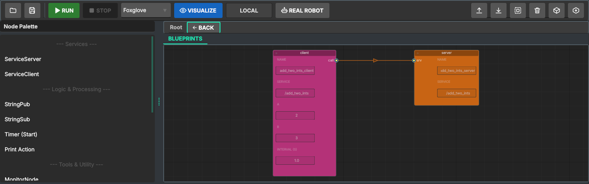
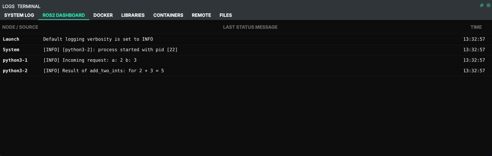

# 4. Service and client

Official tutorials: [Writing a simple service and client (Python)](https://docs.ros.org/en/humble/Tutorials/Beginner-Client-Libraries/Writing-A-Simple-Py-Service-And-Client.html) ·
[(C++)](https://docs.ros.org/en/humble/Tutorials/Beginner-Client-Libraries/Writing-A-Simple-Cpp-Service-And-Client.html)

## What the official tutorial does

A topic is a stream: the publisher sends, whoever listens receives. A **service** is a request and
an answer: the client sends a request and waits for the response of exactly one server.
The tutorial uses `example_interfaces/srv/AddTwoInts`:

```
int64 a
int64 b
---
int64 sum
```

The server answers with `a + b`. The client takes `a` and `b` from the command line, sends one
request and prints `Result of add_two_ints: for 2 + 3 = 5`.

## In Studio

The palette has a **Services** group with two nodes: **ServiceServer** (orange) and
**ServiceClient** (pink), in Python and in C++.

1. In a Python (or C++) project drag **ServiceServer** and **ServiceClient** onto the canvas.
2. Fields:

   | Node | Fields |
   |---|---|
   | ServiceServer | Name `add_two_ints_server`, Service `/add_two_ints` |
   | ServiceClient | Name `add_two_ints_client`, `a` = 2, `b` = 3, Interval (s) = 1.0 |

3. Connect **call** of the client to **srv** of the server. The client takes the server's service
   name: `'client' now uses service /add_two_ints (wired to 'server')`. For services the *server*
   owns the name (for topics it is the publisher), because one server answers many clients.
4. **Run**.





Every second the client sends a request, the server logs `Incoming request: a: 2 b: 3`, and the
client logs `Result of add_two_ints: for 2 + 3 = 5`.

## What Studio generated

The server (`src/python/server.py`) is the official one:

```python
self.srv = self.create_service(AddTwoInts, '/add_two_ints', self.add_two_ints_callback)

def add_two_ints_callback(self, request, response):
    response.sum = request.a + request.b
    self.get_logger().info('Incoming request: a: %d b: %d' % (request.a, request.b))
    return response
```

The client (`src/python/client.py`) differs on purpose:

```python
self.cli = self.create_client(AddTwoInts, '/add_two_ints')
self.timer = self.create_timer(1.0, self.send_request)

def send_request(self):
    if not self.cli.service_is_ready():
        self.get_logger().info('service not available, waiting again...')
        return
    req = AddTwoInts.Request()
    req.a = 2
    req.b = 3
    future = self.cli.call_async(req)
    future.add_done_callback(lambda f: self.get_logger().info(
        'Result of add_two_ints: for %d + %d = %d' % (req.a, req.b, f.result().sum)))
```

The C++ nodes do the same with `create_service` / `create_client` and `async_send_request`
with a callback.

## Where Studio differs (and why)

- **The client asks again and again.** The official client is a one-shot program: it reads `a` and
  `b` from `sys.argv`, calls `spin_until_future_complete` and exits. A node started by a launch
  file has no command line and should keep running, so Studio's client sends a request every
  *Interval* seconds with the *a* and *b* fields. Put `a` and `b` in your code instead if you need
  real input.
- **The answer comes in a callback, never by waiting.** `call_async` plus `add_done_callback`
  (C++: `async_send_request` with a callback). Waiting for the future inside a timer callback
  (`rclpy.spin_until_future_complete` there, or `future.get()` in C++) blocks the node's only
  executor thread: the response can never be processed and the node hangs. This is the most
  common service bug in ROS 2; the template avoids it.
- **"service not available" is normal at start.** The client may start before the server; it
  checks `service_is_ready()` and tries again on the next tick, like the official
  `wait_for_service` loop.
- **Dependencies.** `example_interfaces` is added to `package.xml`, `CMakeLists.txt` (C++) and the
  Dockerfile from the `#include` / `import`, as in chapter 1.
- **C++ node names.** In a C++ project the launch file names each node after its file, the title
  on the canvas (`server`, `client`), and the *Name* field is not used. Python nodes use *Name*.

## Check it like the official tutorial

```bash
docker exec -it ros2_orchestrator_session bash
source /opt/ros/humble/setup.bash
ros2 service list -t        # /add_two_ints [example_interfaces/srv/AddTwoInts] ...
ros2 service call /add_two_ints example_interfaces/srv/AddTwoInts "{a: 40, b: 2}"
```

```
requester: making request: example_interfaces.srv.AddTwoInts_Request(a=40, b=2)

response:
example_interfaces.srv.AddTwoInts_Response(sum=42)
```

`ros2 service call` is the terminal's version of the client node: handy to test a server before the
client exists.

## What you learned

| Concept (official tutorial) | Where it is in Studio |
|---|---|
| `.srv` interface: request `---` response | `example_interfaces/srv/AddTwoInts` in the generated code |
| `create_service(type, name, callback)` | ServiceServer node, *Service* field |
| `create_client`, `call_async` / `async_send_request` | ServiceClient node, *a*, *b*, *Interval* |
| client and server are matched by service name and type | the *Service* fields; the wire keeps them equal |
| `ros2 service call` | works in the session container |

Next: [chapter 5](05-inspecting-a-running-system.md), looking at all of this while it runs.
