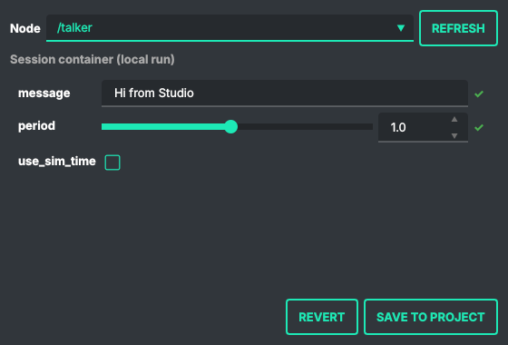
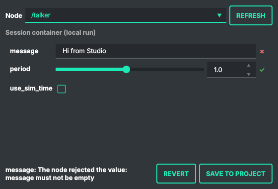

# 6. Parameters, tuned live

Official tutorials: [Using parameters in a class (Python)](https://docs.ros.org/en/humble/Tutorials/Beginner-Client-Libraries/Using-Parameters-In-A-Class-Python.html) ·
[(C++)](https://docs.ros.org/en/humble/Tutorials/Beginner-Client-Libraries/Using-Parameters-In-A-Class-CPP.html) ·
[Understanding parameters](https://docs.ros.org/en/humble/Tutorials/Beginner-CLI-Tools/Understanding-ROS2-Parameters/Understanding-ROS2-Parameters.html)

## What the official tutorial does

A **parameter** is a named setting of a node (a gain, a rate, a frame name) that can be read and
changed from outside while the node runs. The tutorial declares `my_parameter` with
`declare_parameter`, reads it in a timer, changes it with `ros2 param set`, and finally sets it from a
launch file so the node starts with the right value.

## In Studio

Start from the publisher of [chapter 2](02-publisher-subscriber-python.md). Double-click `talker`
and replace **the whole file** with this one: the same publisher, with two parameters, the text
it publishes and the period with a declared range.

```python
import rclpy
from rclpy.node import Node
from rcl_interfaces.msg import FloatingPointRange, ParameterDescriptor, SetParametersResult
from std_msgs.msg import String


class Talker(Node):
    def __init__(self):
        super().__init__('talker')
        self.declare_parameter('message', 'Hello world',
                               ParameterDescriptor(description='Text to publish'))
        # a declared range: Studio shows a slider, and ROS refuses values outside it
        self.declare_parameter('period', 0.5, ParameterDescriptor(
            description='Seconds between messages',
            floating_point_range=[FloatingPointRange(from_value=0.1, to_value=2.0, step=0.1)]))
        # called before a new value is accepted: the node can refuse it or react to it
        self.add_on_set_parameters_callback(self.on_parameters)

        self.pub = self.create_publisher(String, '/chatter', 10)
        self.timer = self.create_timer(self.get_parameter('period').value, self.tick)
        self.i = 0

    def on_parameters(self, params):
        for p in params:
            if p.name == 'message' and not p.value.strip():
                return SetParametersResult(successful=False, reason='message must not be empty')
        for p in params:
            if p.name == 'period':              # a new period needs a new timer
                self.timer.cancel()
                self.timer = self.create_timer(p.value, self.tick)
        return SetParametersResult(successful=True)

    def tick(self):
        msg = String()
        msg.data = f"{self.get_parameter('message').value}: {self.i}"
        self.pub.publish(msg)
        self.get_logger().info(f'Publishing: "{msg.data}"')
        self.i += 1


def main():
    rclpy.init()
    node = Talker()
    try:
        rclpy.spin(node)
    except KeyboardInterrupt:
        pass
    node.destroy_node()
    rclpy.shutdown()


if __name__ == '__main__':
    main()
```

> [!TIP]
> If the node does not show up in the Parameters window, it probably did not start. Double-click
> its row on the ROS2 Dashboard: a Python traceback there (for example `NameError` after renaming
> the class but not the call in `main()`) tells you why.

Two things go beyond the official example, and both matter on a real robot:

- **The range** (`FloatingPointRange`) is part of the parameter. ROS itself refuses `period = 5.0`;
  every tool sees the limits (`ros2 param describe` prints them); Studio draws a slider over exactly
  that range.
- **The callback** runs *before* a new value is accepted. Here it refuses an empty message and
  rebuilds the timer when the period changes. Without it, setting `period` would change the
  parameter but not the timer: the official example only reads its parameter in the timer, so it
  does not need one.

## Tuning in the Parameters window

**Run**, then right-click `talker` → **Parameters…**



- **period** has a slider from 0.1 to 2.0 because the range is declared; **message** is a text field;
  `use_sim_time` is a parameter every node has.
- Drag the slider: the value is sent while you drag (the latest one, about ten times a second),
  and the node applies it at once. `ros2 topic hz /chatter` goes from 2 Hz to 1 Hz when the period
  goes from 0.5 to 1.0. A ✓ next to a row means the node accepted the value.
- Type an empty message: the node refuses it. The field goes back to the value the node has, and
  the node's own reason is shown:



- **Revert** sends back the values the node had when the window opened.
- The **Node** list picks any running node, not only the one you clicked.

The window talks to the node through a small bridge process in the session container
(about 2 ms per change), the same way locally and on a robot connected on the Remote tab.

## Keeping the values: Save to project

Values set in the window live only as long as the node runs. **Save to project** writes the ones
you changed into `src/config/params.yaml`, in the standard ROS format:

```yaml
/talker:
  ros__parameters:
    message: Hi from Studio
    period: 1.0
```

The generated launch file passes this file to every node (`--ros-args --params-file` for Python,
`parameters=[...]` for C++), so the next **Run** starts `talker` with `Hi from Studio` every second.
This is the official tutorial's last step, *change the parameter via a launch file*, without
editing the launch file. The file is in `src/`, so it goes to the robot with your code, and you
can edit it by hand: Studio merges into it and keeps your own entries.

## On the real robot

With **Real robot** on, or with a robot connected on the Remote tab, the window is careful:

- nothing is sent while you drag; the value goes when you release the slider;
- a change of more than 20 % of the range in one step, or any change of a number without a
  declared range, asks for confirmation first;
- **Revert** asks too.

> [!CAUTION]
> A jump of a gain on a real robot is a jerk of a joint. Declaring ranges in your nodes is what
> makes these checks possible, and they do not replace the robot's own emergency stop.

## Check it like the official tutorial

```console
$ ros2 param list /talker
  message
  period
  use_sim_time
$ ros2 param get /talker period
Double value is: 1.0
$ ros2 param set /talker period 5.0
Setting parameter failed: Parameter period out of range Min: 0.1, Max: 2.0, value: 5.0
$ ros2 param set /talker message ''
Setting parameter failed: message must not be empty
```

The terminal and the window go through the same ROS services, so they see the same values and the
same refusals.

## The same in C++

In a C++ project ([chapter 3](03-publisher-subscriber-cpp.md)), double-click `talker` and replace
**the whole file** `src/cpp/talker.cpp` with this one. Run builds it with colcon as usual.

```cpp
#include <chrono>
#include "rclcpp/rclcpp.hpp"
#include "std_msgs/msg/string.hpp"

class Talker : public rclcpp::Node {
public:
    Talker() : Node("talker") {
        rcl_interfaces::msg::ParameterDescriptor period_desc;
        period_desc.description = "Seconds between messages";
        rcl_interfaces::msg::FloatingPointRange range;
        range.from_value = 0.1;
        range.to_value = 2.0;
        range.step = 0.1;
        period_desc.floating_point_range.push_back(range);
        declare_parameter("message", "Hello world");
        declare_parameter("period", 0.5, period_desc);

        on_set_ = add_on_set_parameters_callback(
            [this](const std::vector<rclcpp::Parameter> & params) {
                rcl_interfaces::msg::SetParametersResult result;
                result.successful = true;
                for (const auto & p : params) {
                    if (p.get_name() == "message" && p.as_string().empty()) {
                        result.successful = false;
                        result.reason = "message must not be empty";
                        return result;
                    }
                }
                for (const auto & p : params) {
                    if (p.get_name() == "period") {
                        restart_timer(p.as_double());
                    }
                }
                return result;
            });
        pub_ = create_publisher<std_msgs::msg::String>("/chatter", 10);
        restart_timer(get_parameter("period").as_double());
    }

private:
    void restart_timer(double period) {
        timer_ = create_wall_timer(std::chrono::duration<double>(period), [this]() {
            std_msgs::msg::String msg;
            msg.data = get_parameter("message").as_string() + ": " + std::to_string(count_++);
            pub_->publish(msg);
            RCLCPP_INFO(get_logger(), "Publishing: '%s'", msg.data.c_str());
        });
    }
    rclcpp::Publisher<std_msgs::msg::String>::SharedPtr pub_;
    rclcpp::TimerBase::SharedPtr timer_;
    OnSetParametersCallbackHandle::SharedPtr on_set_;
    size_t count_ = 0;
};

int main(int argc, char ** argv) {
    rclcpp::init(argc, argv);
    rclcpp::spin(std::make_shared<Talker>());
    rclcpp::shutdown();
    return 0;
}
```

- Keep the handle `on_set_` (an `OnSetParametersCallbackHandle::SharedPtr` member): when it is
  destroyed, the callback is removed and the node stops refusing values.
- In the Parameters window a C++ node also shows `qos_overrides.…` parameters: rclcpp declares
  them itself, read-only. Leave them alone.
- Checked the same way as the Python node: `period` 1.0 applies, 5.0 is refused by the range,
  an empty `message` by the callback.

## What you learned

| Concept (official tutorial) | Where it is in Studio |
|---|---|
| `declare_parameter`, `get_parameter` | in your node's code |
| parameter descriptor, range | the slider and its limits in the Parameters window |
| `ros2 param list / get / set` | the Parameters window; the commands work in the container |
| refusing a value | `add_on_set_parameters_callback`; the reason shows in the window |
| parameters from a launch file | **Save to project** → `src/config/params.yaml` → the generated launch |

Next: [chapter 7](07-launch-files.md), launch files.
